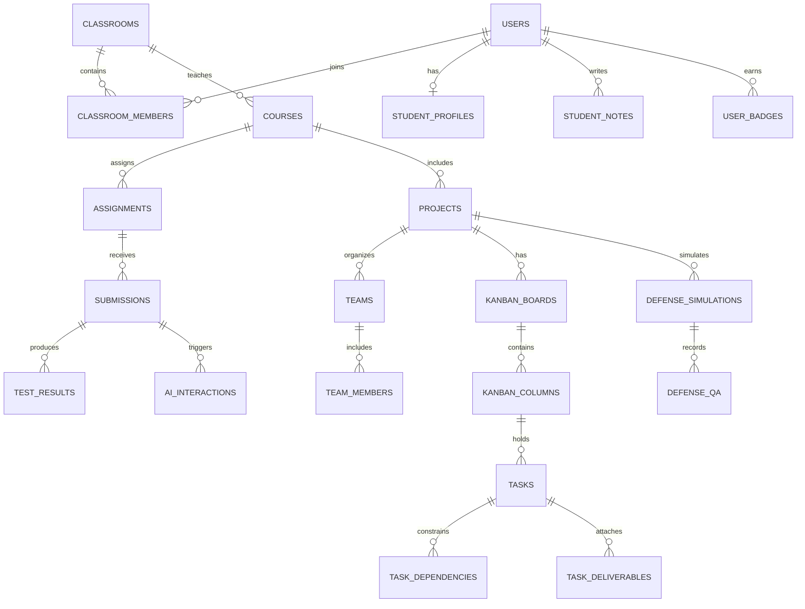

# BẢN ĐẶC TẢ YÊU CẦU PHẦN MỀM VÀ THIẾT KẾ KIẾN TRÚC TOÀN DIỆN
## DỰ ÁN: CODEMIND CAMPUS (v3.1 - MASTER BLUEPRINT)

**Hệ sinh thái:** Học tập Lập trình Chuẩn Công nghiệp (VS Code & Git), Chấm code Tự động, Quản trị Đồ án Kỹ thuật, Mô phỏng Bảo vệ Đồ án với AI & Hệ thống Cá nhân hóa Lôi cuốn (Dev Gamification)  
**Quy mô thực hiện:** Nhóm 03 thành viên  
**Giảng viên hướng dẫn:** Thầy Nguyễn Phước  
**Ngày cập nhật:** 02/11/2026  

---

# MỤC LỤC
1. [TỔNG QUAN HỆ THỐNG & ĐỊNH VỊ ĐỀ TÀI](#1-tổng-quan-hệ-thống--định-vị-đề-tài)
2. [CHI TIẾT NHÁNH 1: LMS HỌC TẬP & CHẤM CODE CHUẨN CÔNG NGHIỆP](#2-chi-tiết-nhánh-1-lms-học-tập--chấm-code-chuẩn-công-nghiệp)
   - 2.1. Nghiệp vụ Giảng viên (Tạo môn, Soạn bài, Thiết lập Test cases)
   - 2.2. Nghiệp vụ Sinh viên (Đọc đề & Docs, Code trên VS Code, 2 hình thức nộp bài)
   - 2.3. Trợ giảng Socratic AI Tutor (Cơ chế đọc code, 3 tầng Hint, Guardrails)
   - 2.4. Kiến trúc Code Runner Sandbox (Docker, Timeout, Memory limit)
   - 2.5. Luồng màn hình (UI/UX Flow) Nhánh 1
3. [CHI TIẾT NHÁNH 2: QUẢN TRỊ ĐỒ ÁN KỸ THUẬT & AI DEFENSE SIMULATOR](#3-chi-tiết-nhánh-2-quản-trị-đồ-án-kỹ-thuật--ai-defense-simulator)
   - 3.1. Mô hình Đồ án Cá nhân vs Đồ án Nhóm
   - 3.2. 4 Điểm khác biệt cốt lõi vượt trội Trello thường
   - 3.3. AI Senior Tech Lead (Review code, Dự báo trễ hạn, Standup)
   - 3.4. AI Defense Simulator (Phòng mô phỏng bảo vệ đồ án với Hội đồng AI)
   - 3.5. Luồng màn hình (UI/UX Flow) Nhánh 2
4. [HỆ THỐNG CÁ NHÂN HÓA & TRẢI NGHIỆM LÔI CUỐN (DEV GAMIFICATION & PERSONALIZATION)](#4-hệ-thống-cá-nhân-hóa--trải-nghiệm-lôi-cuốn-dev-gamification--personalization)
   - 4.1. Chuỗi ngày lập trình liên tục (Daily Coding Streak)
   - 4.2. Bộ sưu tập Huy hiệu & Danh hiệu Lập trình (Dev Badges & Titles)
   - 4.3. Sổ tay Đúc kết Sai lầm Thông minh (Smart Error-to-Note)
   - 4.4. Cá nhân hóa Giao diện Lập trình viên (Developer Themes & Workspace)
   - 4.5. Biểu đồ Radar Năng lực & Bảng Vinh danh Lớp học
5. [ĐẶC TẢ QUY TẮC CỨNG / MỀM & LOGIC LẬP LỊCH (RULES SPECS)](#5-đặc-tả-quy-tắc-cứng--mềm--logic-lập-lịch-rules-specs)
   - 5.1. Danh mục Quy tắc Cứng (Hard Constraints H1 - H6)
   - 5.2. Danh mục Quy tắc Mềm (Soft Constraints S1 - S5)
6. [THIẾT KẾ CƠ SỞ DỮ LIỆU & QUẢN LÝ MÚI GIỜ (ERD & TIMEZONE SPEC)](#6-thiết-kế-cơ-sở-dữ-liệu--quản-lý-múi-giờ-erd--timezone-spec)
   - 6.1. Sơ đồ ERD quan hệ thực thể
   - 6.2. Đặc tả chi tiết các bảng CSDL (PostgreSQL Schema)
   - 6.3. Chiến lược Quản lý Múi giờ chuẩn UTC 3 lớp
   - 6.4. Cơ chế Đồng bộ Dữ liệu Real-time (WebSocket) & External Calendar
7. [DANH MỤC RESTFUL API & WEBSOCKET CONTRACT](#7-danh-mục-restful-api--websocket-contract)
8. [PHÂN CÔNG CÔNG VIỆC NHÓM 3 NGƯỜI & LỘ TRÌNH 4 TUẦN](#8-phân-công-công-việc-nhóm-3-người--lộ-trình-4-tuần)

---

# 1. TỔNG QUAN HỆ THỐNG & ĐỊNH VỊ ĐỀ TÀI

### 1.1. Bối cảnh & Điểm nghẽn thực tế
Trong đào tạo CNTT tại các trường đại học, quy trình giảng dạy đang bị phân mảnh nghiêm trọng:
- **Lý thuyết & Bài tập tuần:** Nộp bài qua LMS truyền thống (Moodle/Google Classroom) rất thụ động, giảng viên phải chấm thủ công, sinh viên dễ dàng copy code ChatGPT nộp đối phó mà không hiểu bản chất.
- **Đồ án môn học:** Sinh viên quản lý công việc rời rạc qua Trello/Zalo; giảng viên không nắm được tiến độ thực sự và không đo lường được ai gánh team, ai lười biếng.
- **Giai đoạn bảo vệ đồ án:** Sinh viên thiếu kỹ năng phản biện kỹ thuật, thường bị điểm kém khi ra hội đồng do không lường trước được các câu hỏi phản biện của thầy cô.
- **Trải nghiệm người học khô khan:** Hệ thống đại học thường xơ cứng, thiếu tính tương tác và không có yếu tố tạo động lực (gamification) khiến sinh viên nhanh nản lòng.

### 1.2. Giải pháp CodeMind Campus (Kiến trúc Toàn diện)
CodeMind Campus tích hợp trọn vẹn 3 trụ cột thành một nền tảng thống nhất:
- **Nhánh 1 (LMS & Code Grader):** Học theo lộ trình tuần, sinh viên lập trình thực tế trên **VS Code**, nộp bài qua **Git/GitHub** hoặc **kéo thả file**, hệ thống chấm test tự động và có **Socratic AI Tutor** kèm cặp sửa lỗi.
- **Nhánh 2 (Project Workspace & AI Defense):** Bảng Kanban quản trị đồ án (Cá nhân/Nhóm), có **AI Senior Tech Lead** rà soát chất lượng code, thuật toán chống gánh team, và phòng **AI Defense Simulator** luyện phản biện bảo vệ đồ án ảo.
- **Phân hệ Phụ trợ Cá nhân hóa (Dev Gamification):** Chuỗi ngày code liên tục (Streak), Sổ tay đúc kết lỗi sai, Hệ thống Huy hiệu IT, Theme giao diện lập trình và Biểu đồ Radar kỹ năng giúp việc học trở nên lôi cuốn và đầy cảm hứng.

---

# 2. CHI TIẾT NHÁNH 1: LMS HỌC TẬP & CHẤM CODE CHUẨN CÔNG NGHIỆP

```
┌─────────────────────────────────────────────────────────────────────────────┐
│                 KIẾN TRÚC NHÁNH 1: LMS & CHẤM CODE TỰ ĐỘNG                  │
├─────────────────────────────────────────────────────────────────────────────┤
│                                                                             │
│  [Giảng viên]                                                               │
│       │                                                                     │
│       ├──> Tạo Môn học / Lớp học (Course & Classroom)                       │
│       ├──> Soạn lộ trình tuần (Syllabus: Tuần 1, Tuần 2...)                 │
│       └──> Tạo Bài tập Coding (Đề bài Markdown, Starter Code, Test Cases)  │
│                                                                             │
│  [Sinh viên]                                                                │
│       │                                                                     │
│       ├──> Xem Đề bài + Đọc tài liệu chuẩn (Official Docs) trên Web        │
│       ├──> Mở VS Code trên máy tính cá nhân để code & debug                 │
│       └──> Nộp bài lên hệ thống:                                            │
│                 ├── Cách 1: Nộp link GitHub Repository (Commit SHA)         │
│                 └── Cách 2: Kéo thả file code trực tiếp (.py, .cpp, .java) │
│                                                                             │
│  [Hệ thống Server & AI]                                                     │
│       │                                                                     │
│       ├──> Docker Sandbox kích hoạt: Chạy Public Tests & Hidden Tests       │
│       ├──> Đạt 100%: Ghi nhận điểm + Lưu bằng chứng học tập (Evidence)      │
│       └──> Bị Fail: Socratic AI Tutor đọc code, giải thích nguyên nhân và    │
│            cung cấp 3 tầng gợi ý định hướng tư duy (Không nhả code sẵn)     │
└─────────────────────────────────────────────────────────────────────────────┘
```

### 2.1. Nghiệp vụ Giảng viên (Instructor Workflow)
1. **Quản lý Môn học & Lớp học:**
   - Tạo khóa học (Course Code, Course Name, Credits).
   - Tạo lớp học phần (Classroom), cấp mã tham gia (Enrollment Code) cho sinh viên hoặc import file danh sách sinh viên Excel/CSV.
2. **Soạn bài giảng & Đính kèm Học liệu:**
   - Tạo cấu trúc tuần: *Mục tiêu bài học*, *Slide bài giảng (PDF)*, *Video minh họa*.
   - **Official Docs Integration:** Đính kèm trích đoạn tài liệu kỹ thuật chuẩn (ví dụ: Python 3.12 `collections.deque`, C++ STL `std::vector`) để sinh viên hình thành thói quen đọc tài liệu gốc.
3. **Thiết lập Bài tập Lập trình (Assignment Configuration):**
   - **Đề bài:** Trình bày định dạng Markdown, hỗ trợ công thức toán KaTeX ($O(N \log N)$), bảng mô tả Input/Output mẫu.
   - **Starter Code:** Mã nguồn khung ban đầu để sinh viên tải về mở trên VS Code.
   - **Cấu hình Bộ Test Cases (JSON Spec):**
     * *Public Test Cases (30%):* Hiển thị đầy đủ Input, Expected Output trên giao diện để sinh viên tự kiểm tra.
     * *Hidden Test Cases (70%):* Các ca kiểm thử biên (Edge cases: rỗng, số âm, mảng $10^5$ phần tử) nhằm chấm điểm thực chất và chống sinh viên hardcode kết quả.
   - **Giới hạn tài nguyên (Sandbox Constraints):** Cấu hình thời gian tối đa chạy 1 test (ví dụ: `timeout = 2000ms`), bộ nhớ tối đa (ví dụ: `memory_limit = 128MB`).
   - **Chính sách Deadline:** Ngày bắt đầu, Hạn nộp mềm (Soft deadline - trừ điểm trễ), Hạn nộp cứng (Hard deadline - đóng cổng nộp).

---

### 2.2. Nghiệp vụ Sinh viên (Student Workflow trên VS Code & Git)
1. **Xem Đề & Tải Starter Code:**
   - Sinh viên vào bài tập, đọc đề bài, xem tài liệu chuẩn tích hợp ngay ở tab bên cạnh.
   - Bấm nút **"Download Starter Code"** (file `.zip` hoặc file `.py`/`.cpp` mẫu) về máy tính.
2. **Lập trình thực chiến trên VS Code:**
   - Sinh viên mở thư mục trên **VS Code** cá nhân, sử dụng toàn bộ sức mạnh của IDE: terminal, linter, phím tắt, format code và gỡ lỗi (debug).
3. **Nộp bài lên Hệ thống (2 Phương thức linh hoạt):**
   - **Phương thức 1 — Nộp qua GitHub (Chuẩn Kỹ sư phần mềm):**
     * Sinh viên đẩy code lên GitHub cá nhân bằng lệnh `git push origin main`.
     * Dán URL GitHub Repo vào ô nộp bài. Hệ thống tự động pull mã nguồn commit mới nhất về để chấm điểm.
   - **Phương thức 2 — Kéo thả File trực tiếp (Nhanh chóng & Tiện lợi):**
     * Sinh viên kéo thả trực tiếp file mã nguồn (`solution.py`, `main.cpp`) từ máy tính vào vùng nộp bài trên web.
     * Hệ thống tự động đọc nội dung file, hiển thị code preview (read-only) và đưa vào hàng đợi chấm.
4. **Xem Bảng Kết quả Kiểm thử (Test Results Dashboard):**
   - Bảng kết quả trả về chi tiết từng ca test: *Test 1 (Passed - 12ms)*, *Test 2 (Passed - 15ms)*, *Test 3 (Failed - Sai kết quả ở input rỗng)*.

---

### 2.3. Trợ giảng Socratic AI Tutor (Cơ chế Kèm cặp Tư duy)
Khi sinh viên nộp bài và bị **FAILED** ở một số test cases, thay vì bế tắc hoặc đi tìm ChatGPT chép code, sinh viên sử dụng tính năng **"Nhờ AI Tutor gợi ý"**:
- **Cơ chế đọc code:** AI Tutor nhận đầu vào gồm: *(1) Mã nguồn sinh viên nộp, (2) Log lỗi từ Test Runner, (3) Tài liệu chuẩn của bài học*.
- **Chính sách Socratic nghiêm ngặt (System Guardrails):**
  - **TUYỆT ĐỐI KHÔNG:** Sinh đoạn code sửa sẵn, không viết lại hàm, không đưa ra đáp án hoàn chỉnh.
  - **NHIỆM VỤ:** Đóng vai một người trợ giảng đặt câu hỏi gợi mở để sinh viên tự nhìn ra lỗi sai trong logic của mình.
- **Thang Gợi ý 3 Cấp độ (3-Level Hint Ladder):**
  * **Level 1 (Định vị & Đặt câu hỏi):** Chỉ ra vị trí hàm hoặc dòng code đang gặp vấn đề: *"Hãy nhìn vào hàm `visit()`. Khi tham số `page` là một chuỗi rỗng `""`, dòng code nào bên dưới vẫn được thực thi?"*
  * **Level 2 (Phân tích nguyên nhân logic):** Đối chiếu với tài liệu chuẩn: *"Theo tài liệu của deque, `maxlen=3` chỉ giới hạn số lượng phần tử chứ không tự kiểm tra giá trị rỗng. Bạn cần một điều kiện bảo vệ (guard condition) trước thao tác nào?"*
  * **Level 3 (Khung tư duy giải pháp):** Đưa ra pseudocode / cấu trúc điều kiện logic (nhưng không nhả code thật): *"Cấu trúc nên có dạng: Nếu input không hợp lệ -> trả về dữ liệu hiện tại ngay lập tức; Ngược lại -> thực hiện append."*
- **Lưu trữ bằng chứng học tập (Evidence Tracking):**
  - Hệ thống ghi nhận: Số lần nộp bài, Mã nguồn lần đầu (bị lỗi) và Mã nguồn cuối cùng (đã sửa thành công), số lượng gợi ý AI đã dùng.
  - Tạo ra minh chứng rõ ràng: Sinh viên đã **tự học, tự sửa lỗi và tiến bộ thật sự**.

---

### 2.4. Kiến trúc Code Runner Sandbox (Môi trường Chấm an toàn)
Để đảm bảo an toàn tuyệt đối cho máy chủ, mã nguồn của sinh viên **không bao giờ được chạy trực tiếp trên server chính**:
- Mỗi bài nộp được đẩy vào hàng đợi (Redis Queue).
- **Worker chạy Docker Container cô lập (Isolated Container):**
  * Bị cắt hoàn toàn kết nối Internet (`--network none`) để chống sinh viên viết code gửi dữ liệu ra ngoài hoặc gọi API gian lận.
  * Giới hạn RAM tối đa: 128MB (`--memory=128m`).
  * Giới hạn CPU: 1 core CPU, chạy tối đa 2 giây (`timeout 2s`). Nếu chạy vòng lặp vô tận, container bị kill ngay lập tức và trả về lỗi `Time Limit Exceeded (TLE)`.
  * Chạy dưới user không có quyền root (`non-root user`) để chống xóa file server.

---

### 2.5. Luồng Màn hình (UI/UX Flow) Nhánh 1
1. **Màn hình Môn học (Course Dashboard):** Danh sách các tuần học, thanh tiến độ hoàn thành (%), danh sách bài tập kèm Deadline đếm ngược.
2. **Màn hình Chi tiết Bài tập (Assignment Workspace):**
   - *Cột trái:* Tab Đề bài (Markdown), Tab Tài liệu chuẩn (Official Docs), Tab Khung chat Socratic AI.
   - *Cột phải:* Khung kéo thả file code / Nhập link GitHub repo, Nút "Nộp bài & Chấm điểm".
3. **Màn hình Kết quả Kiểm thử (Submission Result Modal):**
   - Danh sách các test cases (Tick xanh: Pass, Dấu x đỏ: Fail).
   - Nút **"Mở gợi ý AI Tutor (Hint 1)"** khi có test case fail.
   - Màn hình so sánh mã trước/sau (Diff view) khi đạt 100% test.

---

# 3. CHI TIẾT NHÁNH 2: QUẢN TRỊ ĐỒ ÁN KỸ THUẬT & AI DEFENSE SIMULATOR

```
┌─────────────────────────────────────────────────────────────────────────────┐
│          KIẾN TRÚC NHÁNH 2: SMART PROJECT WORKSPACE & DEFENSE SIMULATOR     │
├─────────────────────────────────────────────────────────────────────────────┤
│                                                                             │
│  [Thiết lập Đồ án]                                                          │
│       ├── Hình thức: Cá nhân (Individual) HOẶC Nhóm (Team 3-5 sinh viên)    │
│       └── AI Task Decomposition: Tự động phân rã đề tài thành các task WBS  │
│                                                                             │
│  [Bảng Kanban Kỹ thuật Thông minh]                                          │
│       ├── Cột chuẩn: Backlog ──> To Do ──> In Progress ──> In Review ──> Done│
│       ├── Ràng buộc Quy tắc cứng: Task con bị chặn nếu task tiền đề chưa Done│
│       └── Gắn liền Sản phẩm: Mỗi task phải đính kèm commit/file mới cho Done│
│                                                                             │
│  [AI Senior Tech Lead Đồng hành]                                            │
│       ├── AI Code Reviewer: Quét code task, chấm điểm Clean Code & Bảo mật │
│       ├── Predictive Delay AI: Dự báo nguy cơ trễ hạn đồ án                 │
│       └── Thuật toán Anti-Freerider: Đo lường % đóng góp thật từng thành viên│
│                                                                             │
│  [AI Defense Simulator - Phòng Bảo vệ Đồ án Ảo]                             │
│       ├── AI đọc toàn bộ Báo cáo SRS/ERD + Code repository của nhóm         │
│       ├── AI đóng vai Giảng viên phản biện khó tính, bật mic hỏi từng bạn   │
│       └── Chấm điểm phản biện & Chỉ ra lỗ hổng kiến trúc trước ngày bảo vệ   │
└─────────────────────────────────────────────────────────────────────────────┘
```

### 3.1. Mô hình Đồ án Cá nhân vs Đồ án Nhóm
Hệ thống linh hoạt hỗ trợ cả 2 hình thức:
- **Đồ án Cá nhân (Individual Project):** Dành cho các môn yêu cầu tự lập trình độc lập. Sinh viên tự quản lý thời gian biểu cá nhân, rèn luyện tính kỷ luật và tự giác hoàn thành task theo từng tuần.
- **Đồ án Nhóm (Team Project):** Dành cho các môn công nghệ phần mềm, đồ án tốt nghiệp. Nhóm có Nhóm trưởng (Team Leader), các thành viên phân chia công việc rõ ràng, tương tác realtime trên cùng một bảng Kanban.

---

### 3.2. 4 Điểm Khác biệt Cốt lõi Vượt trội Trello Thường
Nhóm tự tin bảo vệ đề tài trước hội đồng với 4 tính năng mà Trello không thể làm được:

1. **AI Task Decomposition (Phân rã Đồ án tự động bằng AI):**
   - Sinh viên chỉ cần nhập tên đề tài: *"Hệ thống Bán vé Máy bay Trực tuyến"*.
   - AI tự động phân tích và sinh ra danh mục công việc kỹ thuật chuẩn mực:
     * *Giai đoạn 1 (Thiết kế):* Phân tích Use Cases, Vẽ biểu đồ CSDL ERD, Thiết kế Mockup Figma.
     * *Giai đoạn 2 (Backend):* Cấu hình Database PostgreSQL, Viết API Đăng nhập/JWT, Viết API Đặt vé và Thanh toán.
     * *Giai đoạn 3 (Frontend):* Xây dựng giao diện tìm chuyến bay, Giao diện chọn ghế, Tích hợp API.
     * *Giai đoạn 4 (Kiểm thử):* Viết Unit Tests, Viết tài liệu báo cáo kỹ thuật.
   - Nhóm chỉ cần bấm "Chấp nhận", các thẻ task tự động được đưa vào bảng Kanban kèm deadline gợi ý.

2. **Thuật toán Đo lường Đóng góp thật (Anti-Freerider Algorithm):**
   - Chấm dứt triệt để vấn nạn "1 người gánh team": Hệ thống tính điểm đóng góp dựa trên công thức đa trọng số:
     $$\text{Contribution Score} = w_1 \cdot \text{Tasks Completed} + w_2 \cdot \text{On-Time Delivery Rate} + w_3 \cdot \text{Code Commits Attached}$$
   - Hiển thị trực quan biểu đồ tròn: *Bạn A: 45%, Bạn B: 35%, Bạn C: 20% (Có 2 task trễ hạn)*. Giảng viên mở lớp lên là thấy ngay bằng chứng minh bạch để chấm điểm công bằng.

3. **Rules Engine Chuẩn Kỹ thuật Phần mềm (Ràng buộc cứng):**
   - Trong phát triển phần mềm, không thể viết API khi chưa thiết kế xong CSDL.
   - Bảng Kanban cài đặt **Ràng buộc phụ thuộc (Task Dependency):** Thẻ *"Viết API Đơn hàng"* bị khóa đỏ, sinh viên không thể kéo sang `In Progress` nếu thẻ *"Thiết kế bảng Orders"* chưa đạt trạng thái `Done`.

4. **Task-to-Deliverable Binding (Gắn liền Sản phẩm với Thẻ Task):**
   - Mỗi task trên bảng đều có nút **"Đính kèm sản phẩm kiểm chứng"**: Upload file PDF thiết kế, hoặc dán link Git commit/PR.
   - Muốn kéo thẻ sang `Done` bắt buộc phải có sản phẩm đính kèm; giảng viên bấm vào thẻ là xem được ngay code/báo cáo của task đó.

---

### 3.3. AI Senior Tech Lead (Trợ lý Trưởng nhóm Kỹ thuật)
Đóng vai trò như một kỹ sư kỳ cựu hướng dẫn nhóm làm việc:
1. **AI Code Reviewer tự động:**
   - Khi sinh viên nộp commit vào task, AI tự động quét code: cảnh báo thuật toán chưa tối ưu ($O(N^2)$), cảnh báo nguy cơ lộ mật khẩu hoặc SQL Injection, chấm điểm Clean Code từ 1 đến 10.
2. **Predictive Delay AI (Dự báo nguy cơ trễ hạn):**
   - Dựa trên vận tốc làm việc (Velocity) và thời gian còn lại trước Deadline của giảng viên, AI đưa ra cảnh báo sớm: *"Cảnh báo: Tốc độ hoàn thành task hiện tại của nhóm đang chậm 35%, có 75% nguy cơ không kịp hoàn thành Module Thanh toán trước Deadline tuần tới!"*
3. **Daily Standup Tự động:**
   - Mỗi sáng, AI gửi thông báo ngắn hỏi từng bạn: *"Hôm qua em làm được gì? Hôm nay định làm gì? Có gặp khó khăn kỹ thuật nào cần hỗ trợ không?"* để đôn đốc cả nhóm giữ lửa làm việc.

---

### 3.4. AI Defense Simulator (Phòng Mô Phỏng Bảo Vệ Đồ Án Bằng AI)
*Vũ khí "sát thủ" gây ấn tượng mạnh nhất với hội đồng chấm thi:*

```
[Báo cáo đồ án PDF] + [Mã nguồn GitHub]
                │
                ▼
      ┌──────────────────┐
      │ AI DEFENSE ENGINE │ ───> Phân tích kiến trúc hệ thống, sơ đồ CSDL,
      └────────┬─────────┘      quét các lỗ hổng kỹ thuật trong code
               │
               ▼
┌─────────────────────────────────────────────────────────────┐
│             PHÒNG BẢO VỆ ẢO (VIRTUAL DEFENSE ROOM)          │
├─────────────────────────────────────────────────────────────┤
│ • AI đóng vai Giảng viên phản biện khó tính                │
│ • Bật loa gọi tên từng sinh viên:                          │
│   "Mời bạn B, em phụ trách phần Đăng nhập. Tại sao trong     │
│    bảng Users em không dùng cơ chế Salt khi băm Password?    │
│    Nếu hệ thống bị tấn công Rainbow Table thì xử lý sao?"   │
│ • Sinh viên trả lời (qua Micro giọng nói hoặc gõ phím)      │
│ • AI đánh giá độ chính xác, chấm điểm phản biện và đưa ra   │
│   khuyến nghị chỉnh sửa trước ngày bảo vệ thật              │
└─────────────────────────────────────────────────────────────┘
```

1. **Chuẩn bị dữ liệu mô phỏng:** 1 tuần trước ngày bảo vệ, nhóm bấm kích hoạt phòng mô phỏng. AI nạp toàn bộ Báo cáo đồ án và repo mã nguồn của nhóm.
2. **Cơ chế phản biện trực tiếp:**
   - AI xây dựng bộ câu hỏi xoay quanh 4 trụ cột: *(1) Kiến trúc hệ thống, (2) Thiết kế CSDL, (3) Bảo mật & Tối ưu, (4) Trách nhiệm cá nhân từng thành viên*.
   - AI bật micro gọi đích danh thành viên phụ trách module đó để trả lời.
3. **Báo cáo đánh giá năng lực bảo vệ:**
   - Chấm điểm phản biện của từng thành viên thang điểm 10.
   - Xuất danh sách **"Các điểm yếu chết người cần sửa ngay"** để nhóm kịp thời chuẩn bị câu trả lời trước khi gặp thầy cô thật ngoài đời.

---

### 3.5. Luồng Màn hình (UI/UX Flow) Nhánh 2
1. **Màn hình Tổng quan Đồ án (Project Overview):** Danh sách thành viên, thanh tiến độ tổng thể, biểu đồ đóng góp của từng bạn, các mốc Milestone.
2. **Màn hình Bảng Kanban Kỹ thuật (Engineering Kanban Board):**
   - 5 cột kéo thả mượt mà: `Backlog` | `To Do` | `In Progress` | `In Review` | `Done`.
   - Thẻ task hiển thị: Tiêu đề, Avatar người làm, Tag mức độ ưu tiên (Cao/Trung bình), Icon khóa đỏ (nếu bị vướng ràng buộc phụ thuộc), Icon file đính kèm.
   - Modal Chi tiết Task: Checklist công việc con, vùng đính kèm link Git commit, khung nhận xét của AI Code Reviewer.
3. **Màn hình Phòng Mô Phỏng Bảo Vệ (AI Defense Room):**
   - Giao diện phòng họp hội đồng ảo: Khung hình AI Giảng viên phản biện, bảng câu hỏi tương tác, nút ghi âm giọng nói / khung nhập câu trả lời.
   - Bảng tổng kết kết quả phản biện và phân tích điểm mạnh/yếu của nhóm.

---

# 4. HỆ THỐNG CÁ NHÂN HÓA & TRẢI NGHIỆM LÔI CUỐN (DEV GAMIFICATION & PERSONALIZATION)
*(Tận dụng lại và nâng cấp các màn hình có sẵn trong UI: StudentNotes, StudentReview, Profile Card)*

Để xóa bỏ sự khô khan của các hệ thống LMS trường học thông thường, CodeMind Campus tích hợp hệ thống gamification và cá nhân hóa chuyên biệt dành riêng cho dân lập trình:

```
┌─────────────────────────────────────────────────────────────────────────────┐
│                    HỆ THỐNG CÁ NHÂN HÓA & TRẢI NGHIỆM LÔI CUỐN              │
├─────────────────────┬───────────────────────────┬───────────────────────────┤
│ 1. DAILY STREAK     │ 2. HUY HIỆU & DANH HIỆU   │ 3. SỔ TAY ĐÚC KẾT LỖI SAI │
│ • Biểu đồ đóng góp  │ • "Bug Hunter"            │ • Tự động trích xuất bài  │
│   (GitHub style)    │ • "Clean Code Master"     │   học sau khi sửa bug     │
│ • Giữ lửa chuỗi ngày│ • "Team Anchor"           │ • AI gợi ý "Flash Note"   │
│   học & code        │ • "Night Owl Developer"   │ • Lưu trữ tra cứu cá nhân │
├─────────────────────┼───────────────────────────┼───────────────────────────┤
│ 4. DEV THEMES       │ 5. BIỂU ĐỒ RADAR KỸ NĂNG  │ 6. LEADERBOARD LỚP HỌC    │
│ • Dracula / OneDark │ • 5 trục năng lực IT      │ • Xếp hạng tinh thần      │
│ • Cyberpunk / Retro │ • Tăng exp theo bài tập   │ • Tôn vinh nỗ lực bền bỉ  │
│ • Avatar Pixel Dev  │ • Minh chứng thực tế      │ • Chống toxic, đề cao sửa │
└─────────────────────┴───────────────────────────┴───────────────────────────┘
```

### 4.1. Chuỗi Ngày Lập Trình Liên Tục (Daily Coding Streak)
- **Cơ chế:** Lấy cảm hứng từ biểu đồ xanh đóng góp của GitHub và ngọn lửa Streak của Duolingo:
  * Mỗi ngày sinh viên có ít nhất 1 hành động học tập (nộp bài tập, kéo task đồ án, hỏi AI Tutor hoặc đọc tài liệu chuẩn) $\rightarrow$ Ngọn lửa Streak được duy trì và tăng thêm 1 ngày.
  * Hiển thị bảng **Contribution Heatmap** (lưới ô vuông màu xanh) ngay trên trang cá nhân của sinh viên.
- **Tính năng Cứu Streak (Streak Freeze):** Nếu sinh viên lỡ bận 1 ngày trong tuần, hệ thống cho phép dùng điểm kinh nghiệm tích lũy để "đóng băng chuỗi ngày" mà không bị mất chuỗi.

### 4.2. Bộ Sưu Tập Huy Hiệu & Danh Hiệu Lập Trình (Dev Badges & Titles)
Hệ thống trao tặng các huy hiệu độc đáo dựa trên hành vi học tập và kỹ năng thực tế:
1. 🐛 **Huy hiệu "Bug Hunter" (Dũng sĩ diệt bọ):** Trao cho sinh viên tự tìm ra và sửa thành công 5 lỗi corner case phức tạp mà không cần mở đến Hint 3.
2. 💎 **Huy hiệu "Clean Code Master":** Trao cho sinh viên có mã nguồn được AI Code Reviewer chấm điểm phong cách $\ge 9.5/10$ liên tục trong 3 bài tập.
3. ⚓ **Huy hiệu "Team Anchor" (Trụ cột đồ án):** Trao cho thành viên hoàn thành 100% các task được giao đúng hạn trên bảng Kanban đồ án.
4. 🦉 **Huy hiệu "Night Owl Dev" (Lập trình viên Cú đêm):** Mở khóa khi sinh viên commit code và pass test trong khung giờ 00:00 - 04:00 sáng.
5. ⚡ **Huy hiệu "Fast Fixer":** Sửa thành công bài tập ngay trong lần nộp thứ 2 sau khi nhận gợi ý Level 1.
- Sinh viên có thể chọn 1 **Danh hiệu chính (Title)** để hiển thị cạnh tên của mình trên lớp (ví dụ: *Nguyễn Văn A — Clean Code Master*).

### 4.3. Sổ Tay Đúc Kết Sai Lầm Thông Minh (Smart Error-to-Note)
*(Nâng cấp trực tiếp từ component `StudentNotes` sẵn có trong frontend)*
- **Ý nghĩa sư phạm:** Người lập trình giỏi không phải là người không bao giờ gặp lỗi, mà là người biết đúc kết sau mỗi lần gặp lỗi.
- **Cơ chế hoạt động:**
  - Mỗi khi sinh viên nộp bài bị Fail và sau đó tự sửa thành công (Self-correction), hệ thống hiện pop-up nhỏ:
    > *"Chúc mừng bạn đã vượt qua lỗi chuỗi rỗng! Bạn có muốn ghi lại 1 dòng đúc kết vào Sổ tay cá nhân không?"*
  - **AI Auto-Summary:** AI gợi ý sẵn 1 câu tóm tắt đúc kết kỹ thuật:
    *Ví dụ: "Lưu ý bài Deque: maxlen=3 không lọc dữ liệu rỗng; luôn cần đặt `if not page: return` trước khi append."*
  - Sinh viên bấm lưu, ghi chú này sẽ bay vào trang **Sổ tay Lập trình viên (Personal Dev Notes)**. Khi chuẩn bị thi cuối kỳ hoặc phỏng vấn, sinh viên chỉ cần mở sổ tay ra là có toàn bộ bí kíp "xương máu" do chính mình trải nghiệm!

### 4.4. Cá nhân hóa Giao diện Lập trình viên (Developer Themes & Workspace)
Dân IT cực kỳ thích cá nhân hóa không gian làm việc của mình:
- **Bộ Themes chuẩn IDE:** Sinh viên có thể đổi giao diện toàn hệ thống theo các theme lập trình nổi tiếng:
  * 🧛 **Dracula Theme** (Tối huyền bí - Tím dạ quang).
  * 🌌 **One Dark Pro** (Chuẩn VS Code hiện đại).
  * 🌆 **Cyberpunk 2077** (Vàng neon & Đen tương phản cao).
  * ☕ **Monokai Pro** (Cổ điển và tập trung).
- **Custom Avatar Pixel:** Cho phép chọn các avatar pixel art đại diện cho phong cách developer (Frontend Wizard, Backend Ninja, DevOps Guru, Bug Terminator).

### 4.5. Biểu đồ Radar Năng lực & Bảng Vinh danh Lớp học
1. **Biểu đồ Radar Năng lực Cá nhân (5 Trục Kỹ năng):**
   - Thay vì một con điểm GPA khô khan, hồ sơ sinh viên hiển thị mạng nhện năng lực:
     * *Tư duy Cấu trúc dữ liệu & Giải thuật (Algorithm)*
     * *Kỹ năng Gỡ lỗi & Tự sửa lỗi (Debugging)*
     * *Chuẩn mực Mã nguồn (Clean Code)*
     * *Kỹ năng Làm việc nhóm (Team Collaboration)*
     * *Khả năng Phản biện Kỹ thuật (Technical Defense)*
   - Mỗi bài tập làm tốt sẽ cộng điểm kinh nghiệm (EXP) vào trục kỹ năng tương ứng.
2. **Bảng Vinh Danh Lớp Học (Classroom Hall of Fame):**
   - Không xếp hạng theo kiểu so kè điểm số gây áp lực (toxic), mà vinh danh theo các tiêu chí tích cực:
     * *Top Chuỗi Ngày Học Bền Bỉ Nhất (Top Streaks).*
     * *Top Người Tiến Bộ Nhất (Most Improved).*
     * *Top Trợ Thủ Đồ Án Xuất Sắc (Best Team Player).*

---

# 5. ĐẶC TẢ QUY TẮC CỨNG / MỀM & LOGIC LẬP LỊCH (RULES SPECS)
*(Đáp ứng chuẩn mực yêu cầu trong tin nhắn của Thầy Nguyễn Phước)*

```
                           YÊU CẦU ĐẶT / NỘP / KÉO THẺ
                                        │
                         [Kiểm tra Quy tắc Cứng (Hard)]
                                        │
               ┌────────────────────────┴────────────────────────┐
              Vi phạm                                          Thỏa mãn
               ▼                                                 ▼
        [CHẶN HÀNH ĐỘNG]                               [Đánh giá Quy tắc Mềm]
      (Báo lỗi chi tiết)                                         │
                                                                 ▼
                                                       [Tính điểm / Cảnh báo]
                                                                 │
                                                                 ▼
                                                        [CHO PHÉP THỰC HIỆN]
```

### 5.1. Danh mục Quy tắc Cứng (Hard Constraints — Bắt buộc 100%, Vi phạm sẽ chặn)
| Mã | Tên Quy tắc | Phân hệ | Định nghĩa logic & Xử lý vi phạm |
| :--- | :--- | :--- | :--- |
| **H1** | Khóa nộp bài quá hạn *(Hard Deadline)* | LMS / Đồ án | Nếu $\text{Current Time (UTC)} > \text{Hard Deadline (UTC)}$, hệ thống tự động khóa nút Nộp bài, khóa cổng Git Webhook và khóa quyền yêu cầu AI Tutor. |
| **H2** | Ràng buộc phụ thuộc task *(Task Dependency)* | Bảng Kanban | Thẻ Task $B$ phụ thuộc Task $A$. Sinh viên chỉ được kéo $B$ sang `In Progress` khi $A$ đã ở trạng thái `Done`. Vi phạm: Bật thông báo đỏ và tự động đẩy thẻ $B$ về vị trí cũ. |
| **H3** | Ràng buộc sản phẩm kiểm chứng *(Deliverable Binding)* | Bảng Kanban | Không cho phép kéo task sang `Done` nếu thẻ chưa đính kèm tối thiểu 1 file tài liệu hoặc 1 link Git commit/PR kiểm chứng. |
| **H4** | Hạn chót task con *(Subtask Deadline Bound)* | Bảng Kanban | $\text{Due Date}(\text{Task}) \le \text{Due Date}(\text{Milestone}) \le \text{Due Date}(\text{Project})$. Không cho phép đặt deadline task vượt quá deadline của giai đoạn đồ án. |
| **H5** | Giới hạn hạn mức AI *(AI Rate Limit & Quota)* | AI Tutor | Một sinh viên mở tối đa 3 tầng Hint cho 1 bài tập; tối đa 15 yêu cầu hỏi AI trong 1 ngày để chống tình trạng lạm dụng/spam bot. |
| **H6** | Giới hạn quy mô nhóm *(Team Capacity Constraint)* | Quản lý Đồ án | Số lượng thành viên trong 1 nhóm đồ án: $3 \le N_{\text{members}} \le 5$. Một sinh viên chỉ được tham gia duy nhất 1 nhóm trong cùng một môn học. |

---

### 5.2. Danh mục Quy tắc Mềm (Soft Constraints — Tối ưu hóa, Đưa ra Cảnh báo & Trừ điểm)
| Mã | Tên Quy tắc | Phân hệ | Định nghĩa logic & Cơ chế xử lý |
| :--- | :--- | :--- | :--- |
| **S1** | Trừ điểm nộp trễ *(Soft Deadline Penalty)* | LMS | Nếu $\text{Soft Deadline} < \text{Submit Time} \le \text{Hard Deadline}$: Cho phép nộp nhưng tự động trừ $10\%$ tổng điểm cho mỗi 24 giờ nộp muộn. |
| **S2** | Cân bằng tải công việc *(Workload Balancing)* | Bảng Kanban | Nếu 1 thành viên đang nhận $> 55\%$ tổng số task của nhóm: Hệ thống gửi cảnh báo màu vàng lên Dashboard nhóm đề nghị tái phân bổ công việc để tránh 1 người gánh team. |
| **S3** | Cảnh báo dồn hạn chót *(Burnout Prevention)* | Hệ thống | Nếu sinh viên có $\ge 3$ bài tập/đồ án có deadline rơi vào cùng 1 khoảng 48 giờ: Hệ thống tự động cảnh báo đỏ trên trang chủ và gợi ý hoàn thành sớm từ tuần trước. |
| **S4** | Nhắc lịch ôn tập ngắt quãng *(Spaced Repetition)* | AI Tutor | Sinh viên phải dùng đến Hint 3 mới giải được bài tập: Sau 3 ngày hệ thống tự động gửi thông báo nhắc sinh viên làm lại 1 bài tập tương tự để khắc sâu kiến thức. |
| **S5** | Cảnh báo nguy cơ trễ hạn *(Predictive Delay Warning)* | AI Tech Lead | Nếu vận tốc hoàn thành task trung bình của nhóm dự báo đồ án sẽ trễ quá 2 ngày so với ngày bảo vệ: AI tự động gửi cảnh báo lên kênh trao đổi của nhóm. |

---

# 6. THIẾT KẾ CƠ SỞ DỮ LIỆU & QUẢN LÝ MÚI GIỜ (ERD & TIMEZONE SPEC)
*(Đáp ứng chuẩn mực yêu cầu trong tin nhắn của Thầy Nguyễn Phước)*

### 6.1. Sơ đồ Quan hệ Thực thể (ERD Toàn diện)



---

### 6.2. Đặc tả Chi tiết các Bảng CSDL (PostgreSQL Schema)

#### 1. Bảng `users` (Người dùng)
- `id` (UUID, PK): Định danh người dùng.
- `email` (VARCHAR(255), UNIQUE, NOT NULL): Email trường cấp.
- `password_hash` (VARCHAR(255), NOT NULL): Mật khẩu băm Bcrypt.
- `full_name` (VARCHAR(100), NOT NULL): Họ và tên sinh viên/giảng viên.
- `role` (VARCHAR(20), NOT NULL): `student` | `instructor` | `admin`.
- `timezone` (VARCHAR(50), NOT NULL, DEFAULT `'Asia/Ho_Chi_Minh'`): Múi giờ IANA của người dùng.
- `theme_preference` (VARCHAR(30), DEFAULT `'one-dark'`): `dracula` | `one-dark` | `cyberpunk` | `monokai`.
- `created_at` (TIMESTAMPTZ, NOT NULL, DEFAULT NOW()): Thời điểm tạo tài khoản (UTC).

#### 2. Bảng `student_profiles` (Hồ sơ Năng lực & Gamification)
- `id` (UUID, PK), `user_id` (UUID, FK -> `users.id`, UNIQUE).
- `current_streak` (INT, DEFAULT 0): Số ngày giữ chuỗi liên tục.
- `longest_streak` (INT, DEFAULT 0): Kỷ lục chuỗi ngày dài nhất.
- `last_activity_date` (DATE): Ngày hoạt động gần nhất (theo giờ local của user).
- `streak_freezes_available` (INT, DEFAULT 1): Số lượt đóng băng chuỗi còn lại.
- `exp_points` (INT, DEFAULT 0): Tổng điểm kinh nghiệm.
- `selected_title` (VARCHAR(100), DEFAULT `'Novice Developer'`): Danh hiệu được chọn hiển thị.
- `radar_algorithm` (FLOAT, DEFAULT 10.0), `radar_debugging` (FLOAT, DEFAULT 10.0), `radar_cleancode` (FLOAT, DEFAULT 10.0), `radar_teamwork` (FLOAT, DEFAULT 10.0), `radar_defense` (FLOAT, DEFAULT 10.0).

#### 3. Bảng `student_notes` (Sổ tay Đúc kết Lỗi sai Cá nhân)
- `id` (UUID, PK).
- `user_id` (UUID, FK -> `users.id`).
- `assignment_id` (UUID, FK -> `assignments.id`, NULLABLE).
- `title` (VARCHAR(255), NOT NULL): Tiêu đề ghi chú (ví dụ: *"Bẫy chuỗi rỗng trong Deque"*).
- `content` (TEXT, NOT NULL): Nội dung đúc kết bài học.
- `code_snippet` (TEXT): Đoạn code mẫu minh họa bài học.
- `tags` (VARCHAR(100)): Nhãn phân loại (`#deque`, `#corner-case`, `#python`).
- `created_at` (TIMESTAMPTZ, NOT NULL, DEFAULT NOW()).

#### 4. Bảng `user_badges` (Huy hiệu đạt được)
- `id` (UUID, PK), `user_id` (UUID, FK -> `users.id`), `badge_code` (VARCHAR(50)), `badge_name` (VARCHAR(100)), `unlocked_at` (TIMESTAMPTZ, NOT NULL).

#### 5. Bảng `classrooms` (Lớp học phần)
- `id` (UUID, PK), `code` (VARCHAR(50), UNIQUE, NOT NULL), `name` (VARCHAR(255), NOT NULL), `instructor_id` (UUID, FK -> `users.id`), `semester` (VARCHAR(20), NOT NULL), `created_at` (TIMESTAMPTZ, NOT NULL).

#### 6. Bảng `assignments` (Bài tập thực hành / Lý thuyết)
- `id` (UUID, PK), `classroom_id` (UUID, FK -> `classrooms.id`), `title` (VARCHAR(255), NOT NULL), `description_md` (TEXT, NOT NULL), `type` (VARCHAR(20), NOT NULL: `coding` | `quiz` | `report`), `soft_deadline_utc` (TIMESTAMPTZ, NOT NULL), `hard_deadline_utc` (TIMESTAMPTZ, NOT NULL), `max_score` (INT, NOT NULL, DEFAULT 10), `test_cases_json` (JSONB), `starter_code_url` (VARCHAR(255)).

#### 7. Bảng `submissions` (Bài nộp của sinh viên)
- `id` (UUID, PK), `assignment_id` (UUID, FK -> `assignments.id`), `student_id` (UUID, FK -> `users.id`), `submission_method` (VARCHAR(20): `github` | `file_upload`), `github_repo_url` (VARCHAR(255)), `commit_hash` (VARCHAR(64)), `file_path` (VARCHAR(255)), `status` (VARCHAR(20): `queued` | `running` | `passed` | `failed`), `passed_tests_count` (INT, DEFAULT 0), `total_tests_count` (INT, DEFAULT 0), `score` (FLOAT, DEFAULT 0.0), `submitted_at_utc` (TIMESTAMPTZ, NOT NULL, DEFAULT NOW()).

#### 8. Bảng `projects` & `teams` & `tasks` (Đồ án Kỹ thuật & Bảng Kanban)
- `projects.id` (UUID, PK), `classroom_id` (UUID, FK), `title` (VARCHAR(255)), `mode` (VARCHAR(20): `individual` | `team`), `deadline_utc` (TIMESTAMPTZ).
- `teams.id` (UUID, PK), `project_id` (UUID, FK), `team_name` (VARCHAR(100)), `leader_id` (UUID, FK).
- `tasks.id` (UUID, PK), `board_id` (UUID, FK), `column_id` (UUID, FK), `title` (VARCHAR(255)), `description` (TEXT), `assignee_id` (UUID, FK), `priority` (VARCHAR(20)), `due_date_utc` (TIMESTAMPTZ), `position_order` (INT).
- `task_dependencies.id` (UUID, PK), `task_id` (UUID, FK), `depends_on_task_id` (UUID, FK).

#### 9. Bảng `defense_simulations` & `defense_qa` (Mô phỏng bảo vệ đồ án)
- `defense_simulations.id` (UUID, PK), `team_id` (UUID, FK), `conducted_at_utc` (TIMESTAMPTZ), `overall_score` (FLOAT), `summary_feedback` (TEXT).
- `defense_qa.id` (UUID, PK), `simulation_id` (UUID, FK), `student_id` (UUID, FK), `question_text` (TEXT), `answer_text` (TEXT), `evaluation_score` (FLOAT), `critique_notes` (TEXT).

---

### 6.3. Chiến lược Quản lý Múi giờ Chuẩn UTC 3 Lớp (Timezone Strategy)
Để giải quyết triệt để lỗi lệch giờ và bảo vệ tính công bằng khi chấm deadline:
1. **Lớp Lưu trữ (PostgreSQL):**
   - 100% cột thời gian sử dụng kiểu `TIMESTAMPTZ`. PostgreSQL tự động chuyển đổi tất cả mốc thời gian đưa vào về **chuẩn UTC (Offset +00:00)** để lưu trữ.
2. **Lớp Xử lý (FastAPI Backend):**
   - Mọi so sánh logic (kiểm tra bài nộp có trễ hạn không, tính khoảng cách giờ trễ) đều sử dụng đối tượng Python `datetime.now(timezone.utc)`.
   - Backend tuyệt đối không dùng giờ địa phương của server để so sánh.
3. **Lớp Hiển thị (React Client):**
   - Nhận chuỗi thời gian chuẩn ISO-8601 UTC từ API (ví dụ: `2026-11-15T16:59:00Z`).
   - Sử dụng thư viện `date-fns-tz` hoặc `Intl.DateTimeFormat` để tự động render thành giờ địa phương của người dùng (ví dụ máy sinh viên tại VN sẽ hiển thị: `23:59:00 15/11/2026 (GMT+7)`).
   - Khi sinh viên tạo task có chọn deadline, Client tự động convert giờ đã chọn về chuỗi UTC trước khi gửi lên API.

---

### 6.4. Cơ chế Đồng bộ Dữ liệu Real-Time (WebSocket) & Lịch Ngoài
1. **Đồng bộ Bảng Kanban Thời gian thực qua WebSocket:**
   - Mỗi bảng Kanban đồ án là một kênh truyền thông tin (Room: `ws://api.codemind.campus/ws/kanban/{board_id}`).
   - Khi Bạn A kéo thả 1 thẻ task từ `In Progress` sang `Done`, Client phát ra message:
     ```json
     { "event": "TASK_MOVED", "task_id": "...", "from_col": "in_progress", "to_col": "done", "new_position": 2 }
     ```
   - Server kiểm tra Rules Engine (nếu hợp lệ) sẽ broadcast event này tới tất cả thành viên trong nhóm và Giảng viên. Giao diện của tất cả mọi người tự động cập nhật ngay tức thì mà không cần reload trang.
2. **Đồng bộ Lịch ra bên ngoài (Google Calendar / iCal Feed):**
   - Hệ thống cung cấp một URL feed chuẩn iCalendar: `https://api.codemind.campus/v1/calendar/sync/{user_token}.ics`.
   - Sinh viên chỉ cần add URL này vào ứng dụng Google Calendar trên điện thoại: Toàn bộ hạn chót bài tập, deadline task đồ án và ngày mô phỏng bảo vệ sẽ tự động xuất hiện trên lịch điện thoại kèm thông báo nhắc trước 24 giờ.

---

# 7. DANH MỤC RESTFUL API & WEBSOCKET CONTRACT

### 7.1. Nhóm API Xác thực & Người dùng & Gamification (Auth & Gamification)
- `POST /v1/auth/login`: Đăng nhập, nhận JWT Token.
- `GET /v1/users/me`: Lấy thông tin cá nhân, theme, múi giờ.
- `PATCH /v1/users/me/preferences`: Cập nhật theme IDE hoặc múi giờ IANA.
- `GET /v1/students/profile`: Lấy thông số Streak, EXP, radar năng lực và danh sách huy hiệu.
- `POST /v1/students/notes`: Tạo ghi chú bài học đúc kết lỗi sai mới.
- `GET /v1/students/notes`: Lấy danh sách sổ tay ghi chú của sinh viên.

### 7.2. Nhóm API LMS & Chấm Code (Assignments & Submissions)
- `GET /v1/classrooms/{class_id}/assignments`: Lấy danh sách bài tập theo tuần.
- `GET /v1/assignments/{id}`: Xem chi tiết đề bài Markdown, tài liệu chuẩn và public test cases.
- `POST /v1/assignments/{id}/submissions/upload`: Nộp bài bằng cách upload file mã nguồn trực tiếp.
- `POST /v1/assignments/{id}/submissions/github`: Nộp bài bằng link GitHub repo + commit hash.
- `GET /v1/submissions/{id}/status`: Kiểm tra trạng thái chấm bài và kết quả các test cases.
- `POST /v1/submissions/{id}/ai-hints/{level}`: Yêu cầu Socratic AI Tutor mở gợi ý mức 1, 2 hoặc 3.

### 7.3. Nhóm API Quản trị Đồ án & Kanban (Projects & Tasks)
- `POST /v1/projects/{id}/ai-decompose`: Yêu cầu AI tự động phân rã đề tài đồ án thành danh mục task WBS.
- `GET /v1/projects/{id}/kanban`: Lấy toàn bộ cấu trúc bảng Kanban (cột, thẻ, quan hệ phụ thuộc).
- `POST /v1/kanban/tasks`: Tạo thẻ task mới.
- `PATCH /v1/kanban/tasks/{id}/move`: Di chuyển thẻ giữa các cột (Kiểm tra Rules Engine H2, H3).
- `POST /v1/kanban/tasks/{id}/deliverable`: Đính kèm file báo cáo hoặc link commit nghiệm thu task.
- `GET /v1/projects/{id}/contribution-stats`: Lấy số liệu tỷ lệ đóng góp của từng thành viên (Anti-Freerider).

### 7.4. Nhóm API AI Defense Simulator (Mô phỏng Bảo vệ Đồ án)
- `POST /v1/projects/{id}/defense/start`: Khởi tạo phiên mô phỏng bảo vệ đồ án ảo.
- `POST /v1/defense/{sim_id}/submit-answer`: Gửi câu trả lời của sinh viên (text hoặc audio).
- `GET /v1/defense/{sim_id}/report`: Nhận bảng đánh giá năng lực phản biện và danh sách lỗ hổng cần sửa.

---

# 8. PHÂN CÔNG CÔNG VIỆC NHÓM 3 NGƯỜI & LỘ TRÌNH 4 TUẦN

### 8.1. Phân chia Trách nhiệm Chi tiết (Front-to-Back)

| Thành viên | Trách nhiệm Front-End | Trách nhiệm Back-End & Hệ thống | Sản phẩm bàn giao chính |
| :--- | :--- | :--- | :--- |
| **Bạn 1**<br>*(Frontend Lead)* | - Dựng UI Khóa học LMS, xem đề bài & tài liệu chuẩn.<br>- UI Nộp bài (Kéo thả file & Form GitHub) + Bảng hiển thị kết quả test cases.<br>- Dựng **Bảng Kanban kéo thả mượt mà** (`@dnd-kit`).<br>- UI Phòng **AI Defense Simulator** tương tác hội đồng ảo.<br>- Dựng **Giao diện Cá nhân hóa**: Streak Heatmap, Trang Sổ tay ghi chú (`StudentNotes`), Theme switcher & Radar Chart. | - Phối hợp kết nối WebSocket Client.<br>- Xử lý múi giờ Client (`date-fns-tz`). | Toàn bộ giao diện Web React 19 mượt mà, responsive, kéo thả task mượt mà và giao diện cá nhân hóa bắt mắt. |
| **Bạn 2**<br>*(Backend Lead)* | - Phối hợp tích hợp API với Bạn 1. | - Thiết kế Database schema PostgreSQL + Migration (Alembic).<br>- Lập trình toàn bộ cụm RESTful API (Auth, LMS, Assignments, Projects, Tasks, Notes, Profile).<br>- Xử lý upload file an toàn & Webhook kéo code GitHub.<br>- Xử lý chuẩn múi giờ UTC và logic tính điểm nộp muộn. | Hệ thống Backend FastAPI chạy trơn tru, tài liệu Swagger chuẩn chỉ, Unit Tests API đầy đủ. |
| **Bạn 3**<br>*(System, AI & DevOps Lead)* | - Phối hợp hiển thị biểu đồ đóng góp & gợi ý của AI. | - Xây dựng **Automated Test Runner Service** chạy Docker Sandbox cô lập (an toàn, giới hạn RAM/Timeout).<br>- Lập trình **Rules Engine** kiểm tra các quy tắc H1–H6, S1–S5.<br>- Xây dựng **WebSocket Server** đồng bộ thẻ Kanban realtime.<br>- Tích hợp **Gemini API**: Socratic AI Tutor, AI Tech Lead, AI Defense Simulator và Auto-Note Generator.<br>- Đóng gói Docker Compose toàn hệ thống. | Sandbox chấm code an toàn, WebSocket realtime, Hệ thống AI hoạt động thông minh, Docker Compose sẵn sàng chạy. |

---

### 8.2. Kế hoạch Triển khai Sprint 4 Tuần Thực tập Chi tiết

- **TUẦN 1: Chuẩn hóa Tài liệu & Dựng Nền móng Kỹ thuật (Sprint 1)**
  - Gửi bản Đặc tả v3.1 này cho Thầy Nguyễn Phước duyệt chính thức.
  - Setup repository GitHub nhóm, phân quyền nhánh (`main`, `develop`, `feature/*`).
  - Dựng Database PostgreSQL, chạy migration Alembic khởi tạo các bảng dữ liệu lõi.
  - Dựng khung sườn Backend FastAPI (chia module: `api`, `services`, `models`, `schemas`).
  - Dựng khung giao diện React 19 (Tailwind CSS, React Router, Layout Shell, Theme Context).

- **TUẦN 2: Triển khai Nhánh 1 (LMS, Nộp bài VS Code/Git & AI Tutor) (Sprint 2)**
  - Xây dựng giao diện xem đề bài Markdown, tài liệu chuẩn và khu vực nộp bài (kéo thả file/GitHub).
  - Xây dựng Docker Sandbox chạy test case cô lập (Python & C++), so sánh output và đo thời gian.
  - Tích hợp Gemini API với System Prompt Socratic: Đọc code sinh viên nộp, mở lần lượt 3 tầng gợi ý.
  - Tích hợp tính năng Lưu đúc kết vào Sổ tay (`StudentNotes`) sau khi tự sửa lỗi thành công.

- **TUẦN 3: Triển khai Nhánh 2 (Bảng Kanban Đồ án, Real-Time Sync & Gamification) (Sprint 3)**
  - Xây dựng bảng Kanban kéo thả bằng thư viện `@dnd-kit` trên React.
  - Cài đặt WebSocket Server trên FastAPI: Đồng bộ vị trí thẻ task thời gian thực cho cả nhóm.
  - Cài đặt Rules Engine: Chặn kéo task nếu task tiền đề chưa `Done` (H2), chặn task thiếu sản phẩm kiểm chứng (H3).
  - Tích hợp AI Task Decomposition (nhập đề tài tự sinh task) và thuật toán Anti-Freerider.
  - Hoàn thiện giao diện Gamification: Biểu đồ đóng góp Heatmap (Streak), Radar Chart kỹ năng và Huy hiệu dev.

- **TUẦN 4: Hoàn thiện AI Defense Simulator, Đóng gói & Báo cáo (Sprint 4)**
  - Xây dựng phòng Mô phỏng Bảo vệ Đồ án (AI Defense Simulator): Đọc báo cáo PDF/Code, sinh câu hỏi phản biện, chấm điểm câu trả lời.
  - Kiểm thử toàn diện hệ thống: Kiểm tra xử lý múi giờ UTC, test tải WebSocket, bảo mật Sandbox.
  - Đóng gói toàn bộ hệ thống bằng Docker Compose (chạy 1 lệnh `docker-compose up` là lên toàn bộ Web + API + DB).
  - Viết Báo cáo thực tập hoàn chỉnh theo mẫu của trường và thiết kế slide bảo vệ đồ án.
